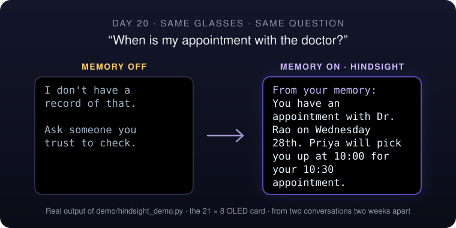
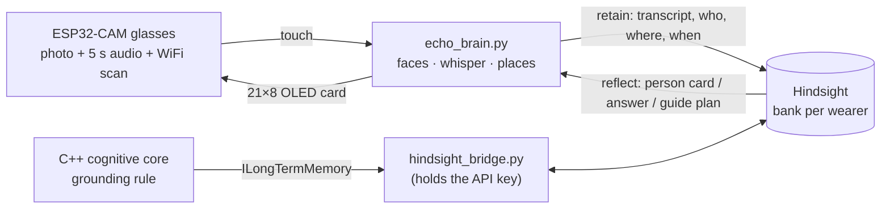

<p align="center">
  
</p>

<h1 align="center">ECHO OS</h1>

<p align="center">
  <b>Smart glasses for people living with memory loss, with a memory that grows alongside them.</b><br>
  On-device perception and a cautious reasoning core, plus long-term memory from
  <a href="https://hindsight.vectorize.io">Hindsight</a>.<br>
  It never guesses: it answers from what you actually lived, or it says so.
</p>

<p align="center">
  
  
  
  
  
  <br>
  
  
  
</p>

<p align="center">
  <a href="#-get-started"></a>
</p>

<p align="center">
  <a href="https://hindsight.vectorize.io">Hindsight docs</a> ·
  <a href="docs/DECISIONS.md#adr-22--long-term-episodic-memory-via-hindsight-opt-in-text-only-grounded-or-silent-amends-adr-5">ADR-22: memory &amp; privacy</a> ·
  <a href="docs/ARCHITECTURE.md">Architecture</a> ·
  <a href="docs/ENGINEERING.md">Engineering log</a>
</p>

<p align="center">
  
  <br>
  <sub>Margaret, 78, asks her glasses the same question with long-term memory off and on.</sub>
</p>

> [!NOTE]
> **Everything shown here is real output.** The cards, plans and answers below were
> produced by the code in this repository against Hindsight Cloud. The full
> transcripts are in [`docs/hindsight/`](docs/hindsight), and you can reproduce them in
> about two minutes with an API key and no hardware.

<p align="center">
  <a href="#the-problem">The problem</a> ·
  <a href="#-how-hindsight-memory-is-used">How memory is used</a> ·
  <a href="#-watch-it-learn">Watch it learn</a> ·
  <a href="#-the-step-by-step-guide">The guide</a> ·
  <a href="#why-memory-not-fine-tuning">Why memory</a> ·
  <a href="#-get-started">Get started</a> ·
  <a href="#under-the-hood">Under the hood</a>
</p>

<br>

### 🧠 Memory is the product
Every conversation is retained, so the glasses can answer "where did I leave my keys?"
and "what did Priya promise?" days later, with dates. Without it, the honest answer is
always *"I don't have a record of that."*

### 🫖 A guide that learns the person
"I want to make a cup of tea" starts a step-by-step guide. On day 1 it walks through
nine generic steps. By day 20 it's four steps, and it already knows the two moments she
still needs a nudge.

### 🛡️ Grounded or silent
Answers come from the record or not at all, and are labelled *"From your memory"*. A
miss, a timeout or a dead network falls back to today's behaviour. It never makes
something up.

### 🔒 Opt-in, text only
Off by default. When on, only words leave the device: never faces, audio, WiFi
fingerprints or sensor data. One bank per wearer, deletable in one call, and
self-hostable.

<br>

## The problem

About 55 million people live with dementia. The cruelest part of early-stage memory loss
isn't forgetting a fact. It's that **the people around you have to remember everything
for you**. They repeat the doctor's appointment five times a day, remind you who the
neighbour is, and talk you through making tea. Carers burn out; the person loses
independence and dignity.

ECHO OS is a pair of glasses that does that remembering. A camera and microphone on an
ESP32-CAM, a reasoning core that would rather say *"I don't know"* than guess, and, new
in this project, **a long-term memory that turns every conversation into something the
glasses can recall weeks later**.

Our test subject is Margaret Ellis, 78 (synthetic, see
[`demo/story.py`](echo-esp32-firmware/demo/story.py)). Over twenty days her daughter
Priya visits, her grandson Arjun is in a school play, the neighbour Mr. Okafor waters her
tomatoes, the nurse checks her blood pressure, Dr. Rao books a follow-up, the pharmacy
changes, and she leaves her keys in the blue bowl. Her glasses heard all of it.

## 🔁 How Hindsight memory is used

[Hindsight](https://github.com/vectorize-io/hindsight) gives ECHO three verbs. Each one
does a specific job:

| Hindsight | When ECHO calls it | What for |
|---|---|---|
| **`retain`** | After every conversation, first meeting, named place, guide session, and anything the wearer says with no known face in view | Stores the full transcript (not a 19-character summary), tagged `person:priya`, `place:home`, `task:make-tea`, with the real timestamp |
| **`reflect`** | A known face appears | *"Priya has just walked up. Who is she to Margaret, and what's open between them?"* → the person card |
| **`reflect`** | Margaret asks about her own life | *"When is my appointment?"* → a dated, grounded answer, or *"no record"* |
| **`reflect` + `response_schema`** | Before each guided task | Classifies every generic step from past sessions as `does_alone` / `needs_reminder` / `needed_help` / `no_info`, with the cue that worked and the evidence. Code builds the plan from that. |
| **`recall`** | Anywhere ranked raw facts are needed | Facts sorted by Hindsight's relevance score, with dates, shown on the live page so you can see *why* it said what it said |



**The bank's mission** tells Hindsight what matters: people and how Margaret knows them,
promises and plans, appointments, preferences and routines, and which step of a task
confused her and which cue helped. The **retain mission** tells it what to extract and
what to ignore (small talk). One bank per wearer, created on first use.

Two places in the code use it:

- **The ESP32 brain** ([`echo_brain.py`](echo-esp32-firmware/echo_brain.py)) via
  [`hindsight_memory.py`](echo-esp32-firmware/hindsight_memory.py): a fail-safe wrapper
  where each lane (background writes, interactive reads) owns its client on its own
  thread. Every read has a deadline, a failure backs off for 60 s, and the result is
  always "an answer or `None`".
- **The C++ cognitive core** through a new
  [`ILongTermMemory`](memory/include/echo/memory/long_term_memory.hpp) seam. When the
  on-device store has no answer to a question about the wearer's own life, long-term
  memory is asked *before* the core abstains. A local
  [bridge](scripts/hindsight_bridge.py) holds the key and asks `reflect` for structured
  `{found, answer}`, so "memory has nothing" comes back as nothing and the core still
  says *"I don't have a record of that."*

## 📈 Watch it learn

The same three moments, replayed into a fresh memory bank as Margaret's life unfolds
(`--curve`). Only memory changes between the columns:

| | Day 1 · 2 memories | Day 5 · 8 memories | Day 20 · 25 memories |
|---|---|---|---|
| **"When is my appointment with the doctor?"** | *"I do not have any record of an appointment with your doctor."* | *"You have an appointment with Dr. Rao on Wednesday 28th at 10:30. Please remember to bring your medication list with you."* | *"You have an appointment with Dr. Rao on Wednesday 28th at 10:30. Priya will pick you up at 10:00. Bring your medication list."* |
| **"Where did I leave my house keys?"** | *"I do not have a record of where you left your house keys."* | *"I do not know where your house keys are. Daniel from number 12 has a spare key if you need one."* | *"You left your house keys in the blue bowl by the front door on Saturday the 24th."* |
| **Priya walks in** | *"Priya is your daughter. She will take you to Friday 6th's school play at 3:30."* | *"Priya is your daughter. You are visiting St. Mary's garden today, Sunday 11th, for Dad's…"* | *"Priya is your daughter. She takes you to Dr. Rao on Wednesday 28th at 10:00."* |

Day 1 says "I don't know" honestly. Day 5 knows the appointment but not who's taking her.
Day 20 knows both, and where the keys are.

And with memory **off** (today's device), on day 20, for the same moments (`docs/hindsight/demo-compare.txt`):

| Moment | Memory off | Memory on |
|---|---|---|
| Priya walks in | *Talked about: "Hello from child", "Lunch not mentioned", "Arrival announced"* | *Priya is your daughter. She takes you to Dr. Rao on Wednesday 28th at 10:00.* |
| "Where did I leave my house keys?" | *I don't have a record of that.* | *You left your house keys in the blue bowl by the front door on Saturday, October 24th.* |
| Mr. Okafor walks in | *Talked about: "Lovely day", "Afternoon", "Margaret"* | *You know Daniel from number 12. He has your spare key and helps with plants.* |
| "Which pharmacy do my prescriptions come from now?" | *I don't have a record of that.* | *Your prescriptions now come from Boots on Station Road. They deliver them to you every Monday.* |

An earlier version of Mr. Okafor's card said *"He owes you a blue dish"*, a promise he'd
kept days before. Reflect is now told to check whether a later memory closed a promise
before repeating it, and to say which time is which (pick-up vs. appointment).

## 🫖 The step-by-step guide

[`guide_agent.py`](echo-esp32-firmware/guide_agent.py) walks the wearer through
everyday tasks one touch at a time (*done*, *help*, *stop*). Hindsight decides what to
skip and what to pre-empt; the code owns the template and the safety rules.

<table>
<tr><th>Day 1 · no history</th><th>Day 5 · two sessions</th><th>Day 20 · six sessions</th></tr>
<tr valign="top"><td>

**9 generic steps**
1. Take a mug from the cupboard.
2. Fill the kettle with water to the line.
3. Switch the kettle on.
4. Wait for the kettle to click off.
5. Put one tea bag in the mug.
6. Pour the hot water into the mug, slowly.
7. Wait three minutes, then take the tea bag out.
8. Add milk and sugar if you like.
9. Your tea is ready. Sit down and enjoy it.

</td><td>

**9 steps, 2 cues from memory**
- Switch the kettle on.<br>*cue: "Pointing at the wall socket with the red switch"*
- Put one tea bag in the mug.<br>*cue: "Green tin to the left of the kettle"*

*"Margaret is learning to use the guide and needed help with most steps yesterday, but she successfully turned on the kettle today after a visual cue."*

</td><td>

**4 steps**
1. Wait for the kettle to click off.<br>*cue: "Wait for the click."*
2. Pour the hot water into the mug, slowly.
3. Wait three minutes, then take the tea bag out.<br>*cue: "Take the bag out now."*
4. Your tea is ready. Sit down and enjoy it.

*"Margaret is increasingly independent with making tea in her yellow mug, though she still benefits from gentle reminders to listen for the kettle clicking off and to remove the tea bag after three minutes."*

</td></tr>
</table>

After every session one summary is retained, e.g. *"Needed help with 'wait for the
kettle to click off' (1x, the cue 'Wait for the click.' was shown). Did these alone: …"*,
and the next plan starts from it.

> [!IMPORTANT]
> **Memory can reword, cue or skip a step; it can never invent one.** Steps must come
> from the template, in order. *Must-keep* steps (hot water, door locks, the cooker) are
> re-inserted if skipped. Anything mentioning medication is replaced with the generic
> step. If memory is unavailable or returns nothing usable, the generic template runs as
> is. Fail safe, not smart.

## Why memory, not fine-tuning

- **The facts are about one person and change every day.** Priya's visit moved, the
  pharmacy changed, the keys are somewhere new. Fine-tuning bakes in a snapshot; memory
  takes a new fact the moment it's said.
- **Every answer must be traceable.** Reflect returns the memories it used, and the live
  page shows them. A fine-tuned weight can't tell a carer *where* it learned that the
  appointment is at 10:30.
- **It must be deletable.** A wearer's life story is theirs. A bank deletes in one call;
  you can't un-train a model on someone's conversations.
- **"I don't know" has to stay possible.** A model trained on a person's life will
  answer fluently whether or not it knows. Retrieval can come back empty, and then ECHO
  says so. For someone who can't fact-check their own glasses, that matters more than
  anything else.
- **No GPU, no training loop, no data pipeline.** It works from the first conversation
  on a $10 camera board and a laptop.

## 🚀 Get started

### The demo (no hardware, about two minutes)

```bash
pip install hindsight-client
# your key from https://ui.hindsight.vectorize.io: env var, or a gitignored file
echo hsk_your_key > HINDSIGHT_API_KEY.env

cd echo-esp32-firmware
python demo/hindsight_demo.py --seed          # load Margaret's 20 days (one batch)
python demo/hindsight_demo.py                 # day 20: memory OFF vs ON, side by side
python demo/hindsight_demo.py --curve         # watch it learn: day 1 → 5 → 20
python demo/hindsight_demo.py --guide         # the tea guide on day 1, 5, 20
python demo/hindsight_demo.py --guide --live  # step through it yourself; it remembers
```

Short display text comes from Groq (`GROQ_API_KEY`, `openai/gpt-oss-120b`) if set, else a
local [Ollama](https://ollama.com) model, else plain rules (`ECHO_LLM=off`). Memory
answers come from Hindsight either way.

### The glasses (ESP32-CAM + laptop brain)

```bash
pip install -r echo-esp32-firmware/requirements.txt
ECHO_HINDSIGHT=on ECHO_WEARER_NAME=Margaret python echo-esp32-firmware/echo_brain.py
# flash the board per echo-esp32-firmware/BRINGUP_NOTES.md, then touch and speak:
#   "hello my name is Priya"           enrol a face
#   "who is this"                      person card from memory
#   "when is my doctor's appointment"  answer from memory
#   "I want to make a cup of tea"      start the guide; touch = next, "help", "stop"
# live view: http://localhost:8080 (shows what Hindsight recalled)
```

### The C++ core (CMake, C++17)

```bash
cmake -S . -B build -G Ninja && cmake --build build && ctest --test-dir build
python scripts/hindsight_bridge.py --bank echo-demo-margaret     # in another terminal
./build/apps-bin/echo-demo --text --headless-hud --hindsight
> when is my appointment with the doctor
From your memory: The doctor's appointment with Dr. Rao is on Wednesday, October 28 at 10:30, with a pickup by Priya at 10:00.
```

Without `--hindsight` the same question gets *"I don't have a record of that, so I'd
rather not guess."* On Windows, run from a *Developer PowerShell for VS*; the whole tree
builds clean with MSVC 14.51 + Ninja.

## Under the hood

- **Grounding rule (Phase 21, unchanged).** A question about the wearer's own life is
  answered from the record or not at all; the LLM is never consulted. Long-term memory
  widens *the record*, not *or not at all*.
- **Writes only on the confident path.** Nothing below the 0.72 input-confidence gate is
  retained; questions never are (`memory::is_question`). Namings and statements are.
- **Fail-safe by construction.** `recall_answer()` returns `nullopt` for "nothing",
  "down" and "timed out" alike, so a caller can only answer from memory or abstain. The
  Python wrapper returns `None`, with a deadline on every read and a 60 s back-off after
  a failure.
- **Never blocks the loop.** Retains go through a queue on a worker thread (C++) or a
  dedicated lane (Python). Reflect takes 5–12 s, so memory answers are a separate path
  from the 120 ms reflex budget, never part of it.
- **Keys stay out of C++.** The bridge owns the key and the SDK on `127.0.0.1`. The C++
  side speaks JSON through `net::IHttpClient`, falling back to the `curl` CLI when built
  without libcurl.
- **Tested.** [`tests/long_term_memory_test.cpp`](tests/long_term_memory_test.cpp) drives
  the real core and store with a fake LLM and a fake backend: hit answers and the model
  is never asked; miss, empty and dead backend abstain; the store still wins; statements
  and namings are retained, questions and shaky transcripts are not. 18/18 suites pass.

| Path | What's there |
|---|---|
| `echo-esp32-firmware/` | ESP32-CAM firmware, `echo_brain.py`, `hindsight_memory.py`, `guide_agent.py`, `llm_client.py`, `demo/` |
| `memory/` | On-device encrypted store, `long_term_memory.hpp` |
| `cognitive-core/` | Safe-mode gate, grounding, LLM orchestration |
| `apps/demo/` | `echo-demo`, `hindsight_ltm.cpp` (bridge client) |
| `scripts/hindsight_bridge.py` | Local bridge between C++ and Hindsight |
| `docs/` | [Architecture](docs/ARCHITECTURE.md) · [Decisions](docs/DECISIONS.md) · [Engineering log](docs/ENGINEERING.md) · [Runbook](docs/RUNBOOK.md) · [Demo transcripts](docs/hindsight) |

> [!IMPORTANT]
> **Honest status.** This is a hackathon prototype on top of a larger research codebase.
> The story is synthetic. The ESP32 upload cycle in `app_main.c` is currently disabled,
> which is why the demo is hardware-free. Reflect latency (5–12 s, Hindsight Cloud)
> suits the touch-and-wait interaction, not live conversation. A dead network costs one
> full read timeout before the back-off kicks in. Nothing here is a medical device.

## Privacy

Memory is **off unless turned on**, per wearer (`ECHO_HINDSIGHT=on`). When on, only text
leaves the device: transcripts, names, relationship and place labels, and guide outcomes.
Never camera frames, face images or descriptors, audio, WiFi fingerprints, EEG, or the
encrypted on-device store. Point `HINDSIGHT_BASE_URL` at a self-hosted `hindsight-api`
and nothing leaves the household at all. Full reasoning and trade-offs:
[ADR-22](docs/DECISIONS.md).

---

<p align="center">
  <sub>
    Built on <a href="https://github.com/Satyabrat2005/echo-os">ECHO OS</a> for the
    Hindsight hackathon by Vectorize. Long-term memory by
    <a href="https://github.com/vectorize-io/hindsight">Hindsight</a>.<br>
    All Rights Reserved
  </sub>
</p>
